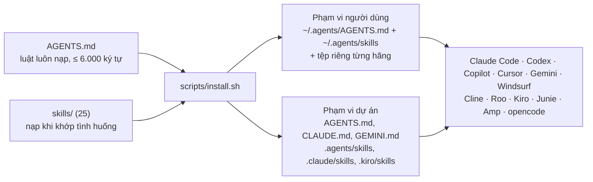

# coding-agent-instructions

Bộ chỉ thị lập trình gọn, trung lập hãng, cho AI coding agent: một tệp luật luôn nạp (`AGENTS.md`, dưới 6.000 ký tự) và 25 skill nạp khi cần theo chuẩn [Agent Skills](https://agentskills.io/specification). Một lệnh cài vào Claude Code, OpenAI Codex, GitHub Copilot, Cursor, Gemini CLI, Windsurf, Cline, Roo Code, Kiro, Junie, Amp, opencode (riêng luật cấp người dùng của Cursor nằm trong phần Settings, phải dán tay; cấp dự án thì tự động); công cụ khác đọc `AGENTS.md` là dùng được.

*A compact, vendor-neutral instruction set for AI coding agents: one always-loaded rules file and 25 on-demand skills, installable into a dozen tools with one command. English summary below.*

## Vì sao có repo này

Nội dung chắt lọc từ các bộ skill cộng đồng đã kiểm định (obra/superpowers, mattpocock/skills, addyosmani/agent-skills, ponytail, tư tưởng của Andrej Karpathy, deepseek-harness, ui-ux-pro-max, impeccable, caveman), cộng bộ luật an toàn thao tác và bảng 41 lớp sai lầm rút từ sự cố thật. Cài nguyên các bộ gốc thì skill trùng nhau tranh nhau kích hoạt, có hook chèn persona vào mọi phiên, có bộ cài kéo mã mới nhất lúc chạy. Ở đây mỗi quy tắc có một chỗ duy nhất, mô tả skill có vế phủ định để không giẫm chân nhau, không hook, không gọi mạng lúc chạy. Nguồn, phiên bản, giấy phép và những gì cố ý bỏ: [SOURCES.md](SOURCES.md).



## Cài đặt

```bash
git clone https://github.com/haintbotast/coding-agent-instructions.git ~/coding-agent-instructions
cd ~/coding-agent-instructions
bash scripts/install.sh --dry-run                    # xem trước, không ghi gì
bash scripts/install.sh --tools claude,codex         # cho người dùng hiện tại
bash scripts/install.sh --project ~/code/my-repo     # vào một dự án (commit các tệp sinh ra)
bash scripts/install.sh --uninstall                  # gỡ đúng phần đã cài
```

Muốn AI tự cài: bảo nó *"Đọc https://github.com/haintbotast/coding-agent-instructions/blob/main/INSTALL.md và cài cho chính bạn"*. [INSTALL.md](INSTALL.md) viết cho agent: chọn phạm vi, cài, kiểm, báo lại; có bảng đường dẫn thủ công cho Windows và công cụ không chạy được bash.

Bộ cài không ghi đè tệp có sẵn: nó chèn một khối giữa hai dấu `coding-agent-instructions:begin/end`, sao lưu tệp trước lần sửa đầu, chỉ thay hoặc gỡ thư mục skill do chính nó cài. Chạy lại là cập nhật. Hành vi này có bài test trong máy ảo HOME tạm (`scripts/test-install.sh`, 38 phép kiểm).

## Có gì bên trong

| Nhóm | Skill |
|---|---|
| Quy trình | `using-skills` (định tuyến, pipeline) · `brainstorming-design` · `grilling` · `writing-plans` · `subagent-driven-dev` |
| Viết mã | `test-driven-development` · `codebase-design` · `domain-modeling` · `prototype` · `zoom-out` · `research` |
| Gỡ lỗi | `systematic-debugging` · `bug-feedback-loop` |
| Nghiệm thu | `verification-before-completion` · `code-review-discipline` · `quality-floor` |
| Git | `branch-lifecycle` · `git-safety` |
| An toàn | `ops-safety` · `failure-classes` · `vetting-third-party` |
| Khác | `writing-skills` · `ui-design` · `handoff` · `terse-mode` |

`AGENTS.md` giữ những luật áp cho mọi việc: giao tiếp và phản biện, thay đổi phẫu thuật, "xong" phải có bằng chứng, luật an toàn cứng, chọn model và sub-agent, tên 41 lớp sai lầm, chỉ mục skill. Phần dài nằm trong skill và chỉ nạp khi cần.

Nội dung viết bằng tiếng Anh để mọi model đọc tốt nhất và ít token nhất; agent vẫn trả lời bằng ngôn ngữ của người dùng (luật đầu tiên của `AGENTS.md`).

## Đóng góp và bảo trì

- Sửa skill hay luật xong chạy `bash scripts/check.sh`, phải in `check: PASS` mới commit. CI chạy lại đúng lệnh đó. Bộ kiểm soát: frontmatter đúng chuẩn, mô tả có vế kích hoạt và vế phủ định, chỉ mục trong `AGENTS.md` khớp thư mục `skills/`, danh sách lớp sai lầm khớp hai nơi, khối luật sau khi cài ≤ 6.000 byte, mô tả hai skill không trùng từ khoá quá 50%, không lộ đường dẫn cá nhân, IP nội bộ, email; tự kiểm các script (mỗi cái phải đỏ khi gài lỗi); test bộ cài.
- Từ khoá riêng tư không được lọt lên public (tên công ty, máy chủ…): ghi vào `~/.config/coding-agent-instructions/denylist.txt` (mỗi dòng một regex, không commit); `check.sh` tự đọc.
- Cập nhật từ upstream: đọc diff upstream, viết lại phần đáng giữ vào đúng skill, sửa SHA ở chân skill và trong `SOURCES.md`.
- Skill mới: theo `skills/writing-skills`; tên chữ thường-gạch-ngang trùng tên thư mục; mô tả bắt đầu bằng "Use when…" và có "Not for…, that is <skill khác>".

## English summary

- **What:** `AGENTS.md` (always-on rules; the installed block stays under Windsurf's 6,000-character global limit, checked by CI) + 25 skills in the open Agent Skills format, distilled from vetted community sources (see [SOURCES.md](SOURCES.md)) plus original ops-safety rules and a 41-class failure taxonomy from real incidents.
- **Install:** `bash scripts/install.sh [--tools …] [--project DIR] [--link] [--dry-run] [--uninstall]`, or tell your agent to follow [INSTALL.md](INSTALL.md).
- **Design choices:** one home per rule; every skill description has a trigger and a negative clause naming the sibling skill; frontmatter limited to standard keys so every tool accepts it; no hooks, no runtime fetching, no telemetry; installer is additive, idempotent, backed up and reversible.
- **Licence:** MIT for original material; third-party parts keep their licences (MIT / Apache-2.0), texts in [`licenses/`](licenses/).
